# design-director

**A design director for people who build without a designer or a product planner.** A Claude Code plugin.

Ask an AI to "make it prettier" or "more modern" and it falls back to the most common answer: purple gradients,
identical rounded cards, emoji icons. Ask for "Swiss style, 12-column grid, 64px headline at -2% tracking, accent
color only on the CTA" and the result changes completely. This plugin closes that gap. It breaks a reference you
like down into a measurable design language, plans and directs your screen with it, applies it to your code only
after you approve the brief, and verifies the result with screenshots.

The skill instructions are written in Korean first (with English design terms); output follows your language.

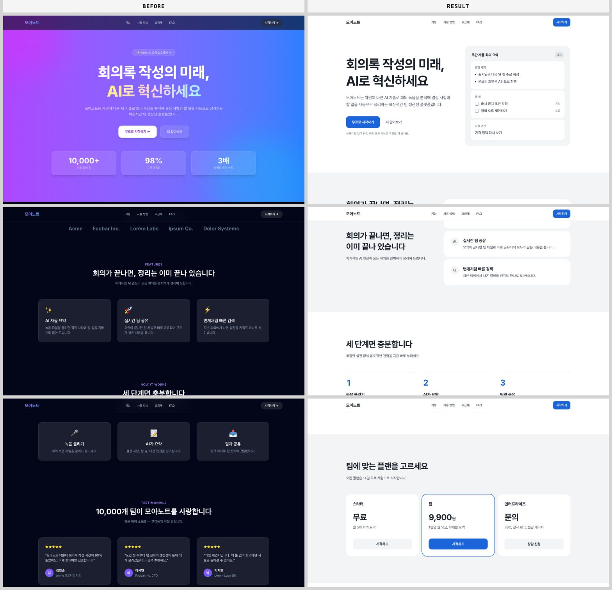

A deliberately "AI-looking" test landing page for a fictional product, after three messages: "make it prettier, it
looks AI-made" → "B" → "apply". Diagnosis score 57 → 91, decisive AI-default tells (S1) 11 → 0, invented stats and
logos removed. Code changed only after the brief was approved.

## Install

```
/plugin marketplace add jungjoongi/design-director
/plugin install design-director@design-director
```

Requires Node.js 20+ and Chrome, Edge, Brave or Chromium for live captures. Nothing else to install.

## Skills

| Skill | What it does | Output |
|---|---|---|
| `/design-director:ref` | Analyzes a URL, screenshot, or style/brand name into a design language: signature moves, measured tokens, page anatomy | `.design/references/<slug>/profile.md` |
| `/design-director:direct` | Plans the page, proposes named directions, writes a design brief, applies it after approval, verifies with before/after screenshots | `.design/briefs/<page>.md`, code changes, verification shots |

Examples:

- `break down what makes https://example.com feel so polished — actual values, not vibes`
- `restyle our landing like this reference: https://example.com — dark and precise, but NOT the purple gradient thing`
- `make our pricing page look more premium; right now it's stock shadcn`

## Style gallery

Each catalog style applied to the kind of screen it suits best (admin, community, fintech app, commerce, …). Brands
and content are fictional, built without photos or logos, and captured with the plugin's own engine. Details (Korean):
[docs/style-gallery.md](docs/style-gallery.md).

<table>
<tr><td width="33%"><a href="docs/style-gallery.md#minimal--미니멀">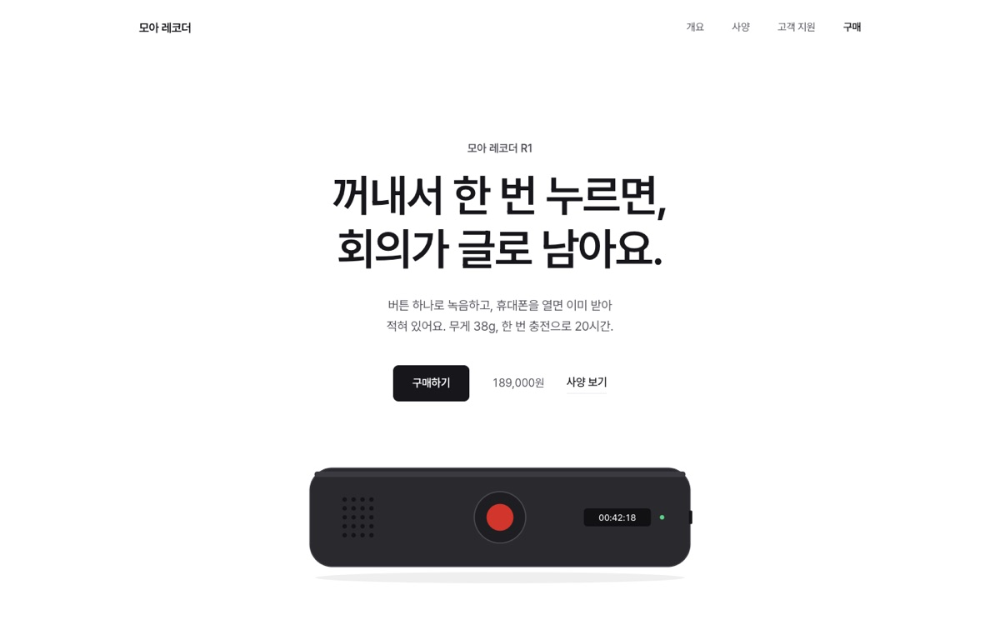</a><br><b>minimal</b></td><td width="33%"><a href="docs/style-gallery.md#swiss--스위스">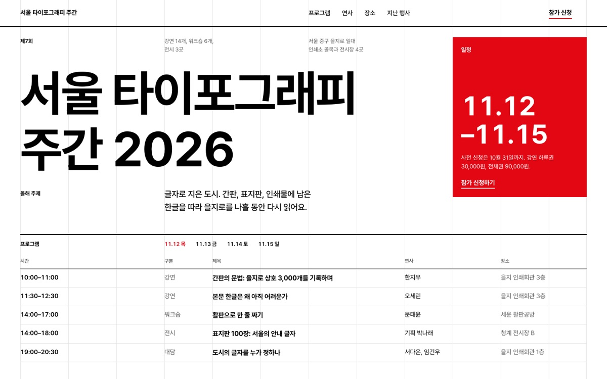</a><br><b>swiss</b></td><td width="33%"><a href="docs/style-gallery.md#editorial--에디토리얼">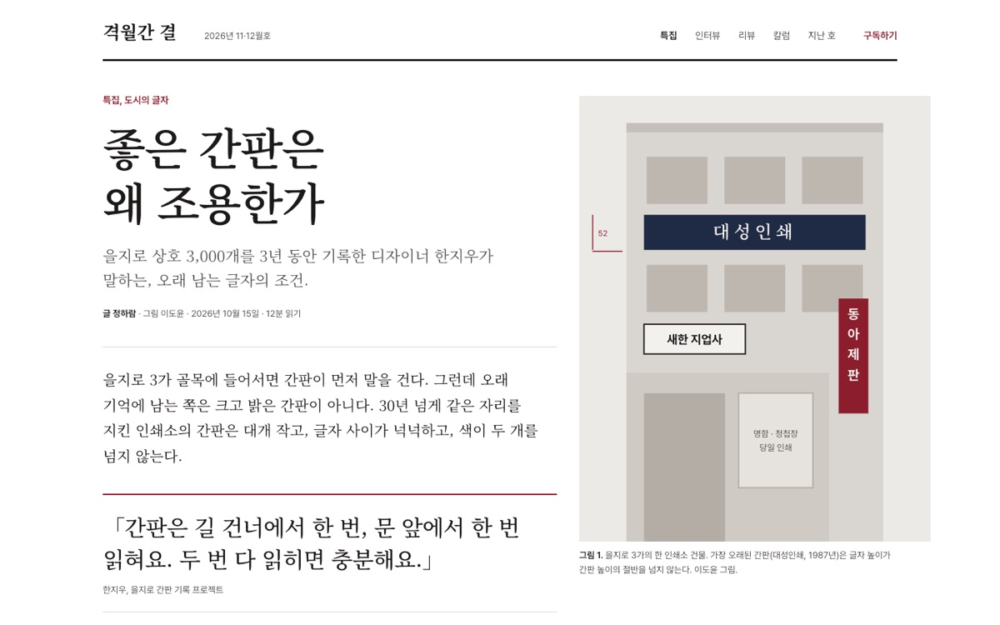</a><br><b>editorial</b></td></tr>
<tr><td width="33%"><a href="docs/style-gallery.md#corporate-clean--코퍼릿-클린">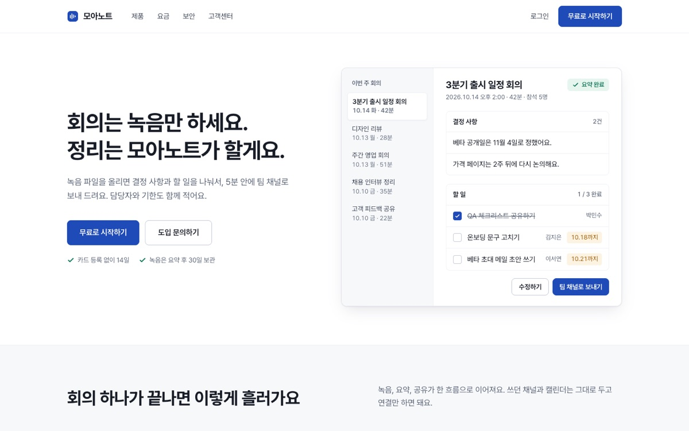</a><br><b>corporate-clean</b></td><td width="33%"><a href="docs/style-gallery.md#data-dense--데이터-밀집-어드민">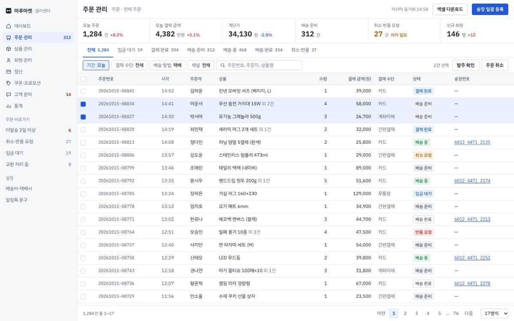</a><br><b>data-dense</b></td><td width="33%"><a href="docs/style-gallery.md#neo-brutalism--네오-브루탈리즘">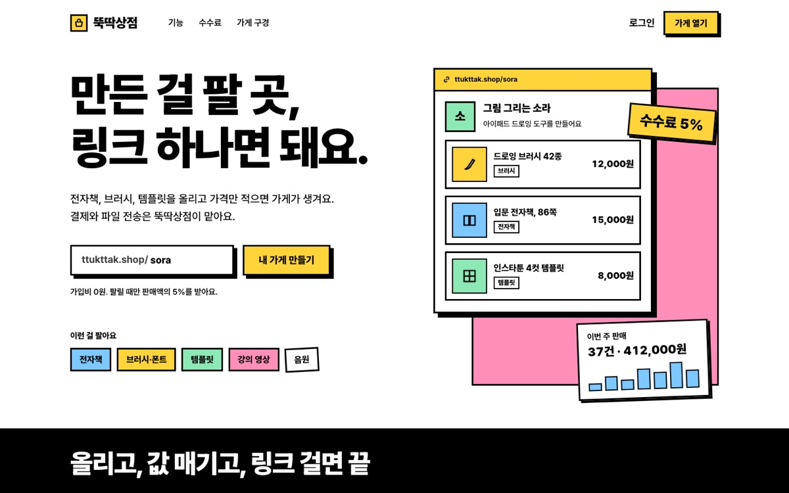</a><br><b>neo-brutalism</b></td></tr>
<tr><td width="33%"><a href="docs/style-gallery.md#playful-illustrative--플레이풀-일러스트-커뮤니티">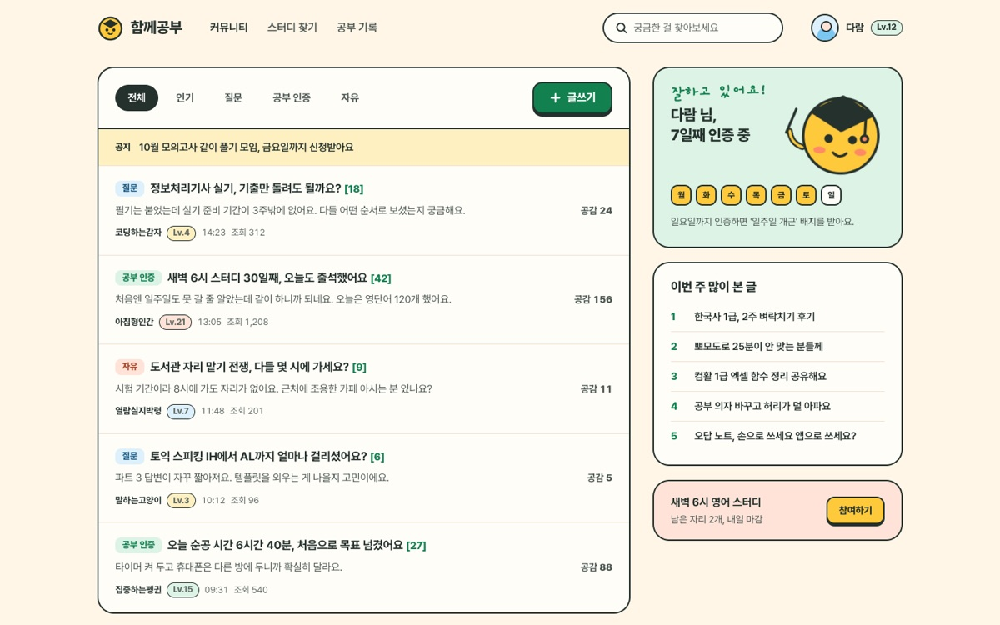</a><br><b>playful-illustrative</b></td><td width="33%"><a href="docs/style-gallery.md#organic-soft--오가닉-소프트">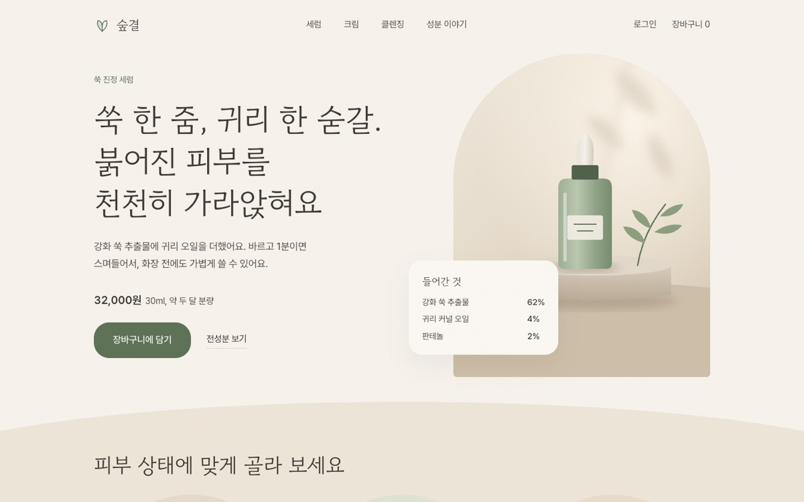</a><br><b>organic-soft</b></td><td width="33%"><a href="docs/style-gallery.md#luxury--럭셔리">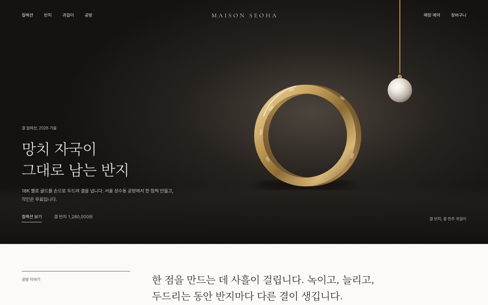</a><br><b>luxury</b></td></tr>
<tr><td width="33%"><a href="docs/style-gallery.md#dark-tech--다크-테크">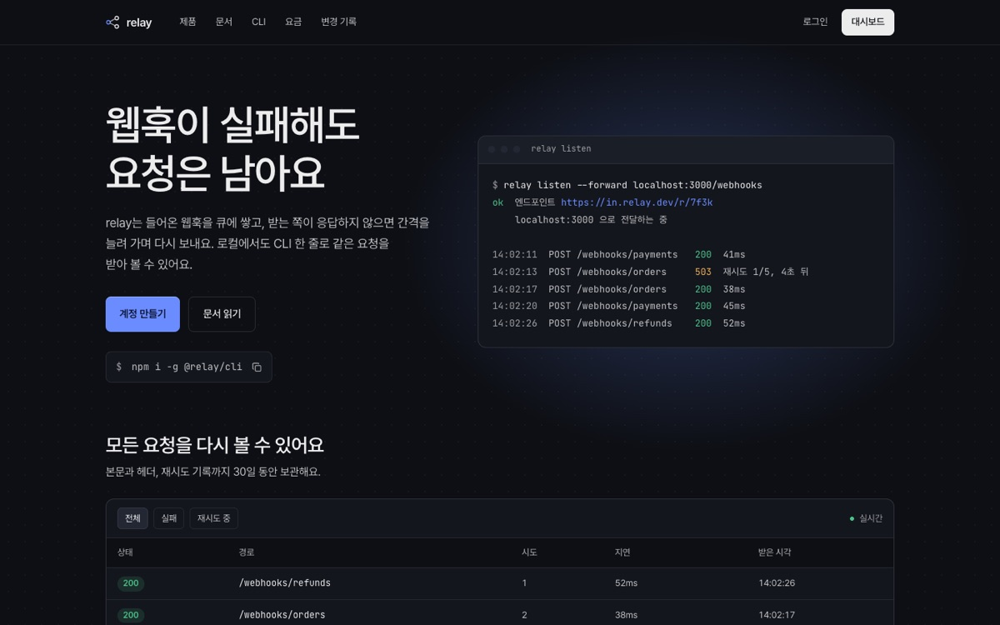</a><br><b>dark-tech</b></td><td width="33%"><a href="docs/style-gallery.md#kr-fintech-simple--한국형-핀테크-심플">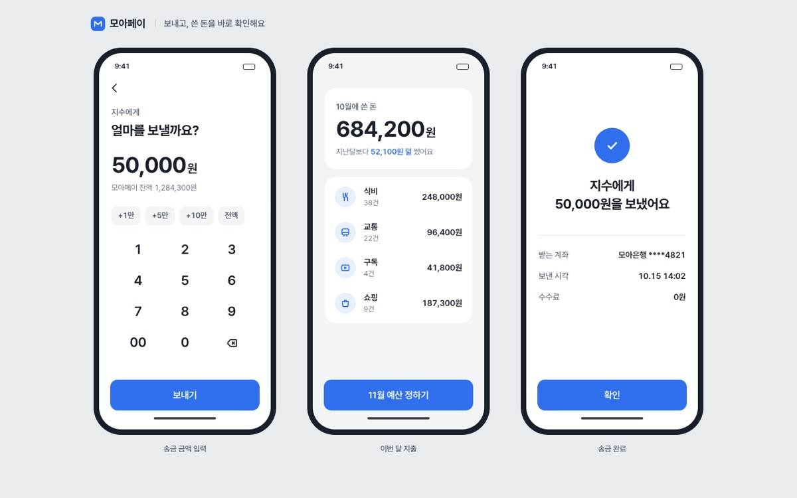</a><br><b>kr-fintech-simple</b></td><td width="33%"><a href="docs/style-gallery.md#kr-editorial-commerce--한국형-에디토리얼-커머스">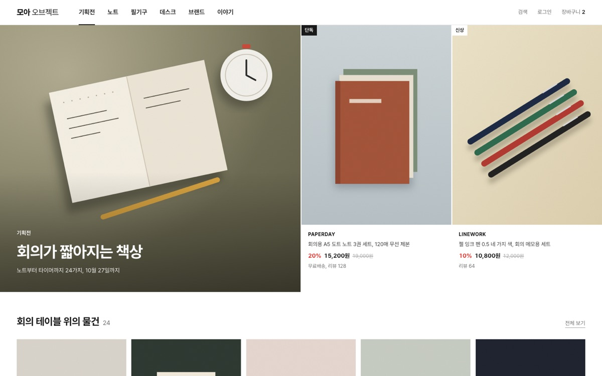</a><br><b>kr-editorial-commerce</b></td></tr>
</table>

## Principles

- Brief first: nothing outside `.design/` changes before you approve.
- No copying: logos, illustrations, photos, copy and paid fonts stay with their owners; proportions, rhythm and tokens transfer.
- No bypassing bot walls or logins; screenshots are used instead, and every value is tagged measured / estimated / derived / catalog.
- Third-party screenshots stay local (`.design/.gitignore`).

## Development

```bash
npm test
claude --plugin-dir plugins/design-director
```

See [docs/architecture.md](docs/architecture.md) and [CLAUDE.md](CLAUDE.md).

## License

MIT
