# design-director

**A design director for people who build without a designer or a product planner.** A Claude Code plugin.

Ask an AI to "make it prettier" and it falls back to the most common answer: purple gradients, identical rounded cards,
emoji icons. design-director breaks a reference you like down into a measurable design language, plans and directs your
screen with it, changes code only after you approve the brief, and verifies the result with screenshots.
Skill instructions are Korean-first with English design terms; output follows your language.

[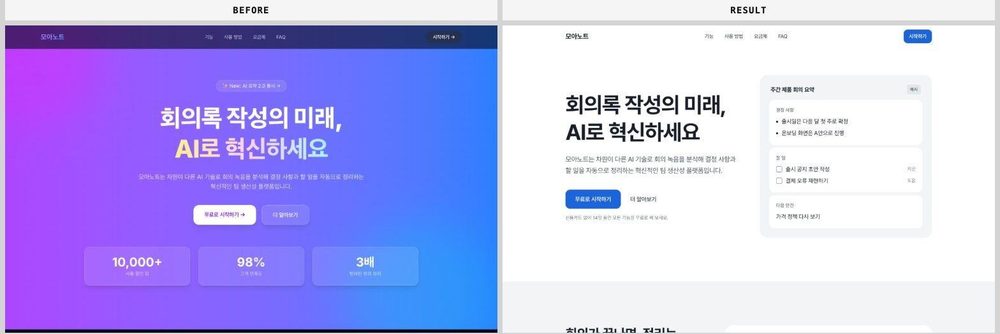](docs/images/before-after-desktop.jpg)

<sub>Three messages to a deliberately "AI-looking" test page: "make it prettier, it looks AI-made" → "B" → "apply".
Score 57 → 91, decisive AI-default tells (S1) 11 → 0, invented stats and logos removed.</sub>

## Install

```
/plugin marketplace add jungjoongi/design-director
/plugin install design-director@design-director
```

Requires Node.js 20+, and Chrome, Edge or another Chromium browser for live captures.

## Usage

| You say | It does |
|---|---|
| "break down what makes https://example.com feel so polished — actual values" | **`ref`** captures the site, measures type, color and spacing, and saves 3–5 signature moves plus token tables as a profile |
| "make this landing look premium, it looks generic" | **`direct`** diagnoses the page, proposes 2–3 named directions, writes a brief, and edits code only after "apply", then compares before/after |
| "set up the board list structure first" | plans sections and an ASCII wireframe from page-type patterns |
| "make the button #2563EB" | exact-value edits are applied directly |

## Style gallery

Each style applied to the kind of screen it suits best. Brands and content are fictional, built without photos or logos,
and captured with the plugin's own engine. Details (Korean): [docs/style-gallery.md](docs/style-gallery.md).

**Landing & brand**

<table>
<tr><td width="33%" valign="top"><a href="docs/style-gallery.md#minimal--미니멀"></a><br><b>minimal</b></td><td width="33%" valign="top"><a href="docs/style-gallery.md#swiss--스위스"></a><br><b>swiss</b></td><td width="33%" valign="top"><a href="docs/style-gallery.md#editorial--에디토리얼"></a><br><b>editorial</b></td></tr>
<tr><td width="33%" valign="top"><a href="docs/style-gallery.md#corporate-clean--코퍼릿-클린"></a><br><b>corporate-clean</b></td><td width="33%" valign="top"><a href="docs/style-gallery.md#neo-brutalism--네오-브루탈리즘"></a><br><b>neo-brutalism</b></td><td width="33%" valign="top"><a href="docs/style-gallery.md#organic-soft--오가닉-소프트"></a><br><b>organic-soft</b></td></tr>
<tr><td width="33%" valign="top"><a href="docs/style-gallery.md#luxury--럭셔리"></a><br><b>luxury</b></td><td width="33%" valign="top"><a href="docs/style-gallery.md#dark-tech--다크-테크"></a><br><b>dark-tech</b></td></tr>
</table>

**Admin**

<table>
<tr><td width="50%" valign="top"><a href="docs/style-gallery.md#data-dense--데이터-밀집"></a><br><b>data-dense</b></td><td width="50%" valign="top"><a href="docs/style-gallery.md#admin-calm--차분한-어드민">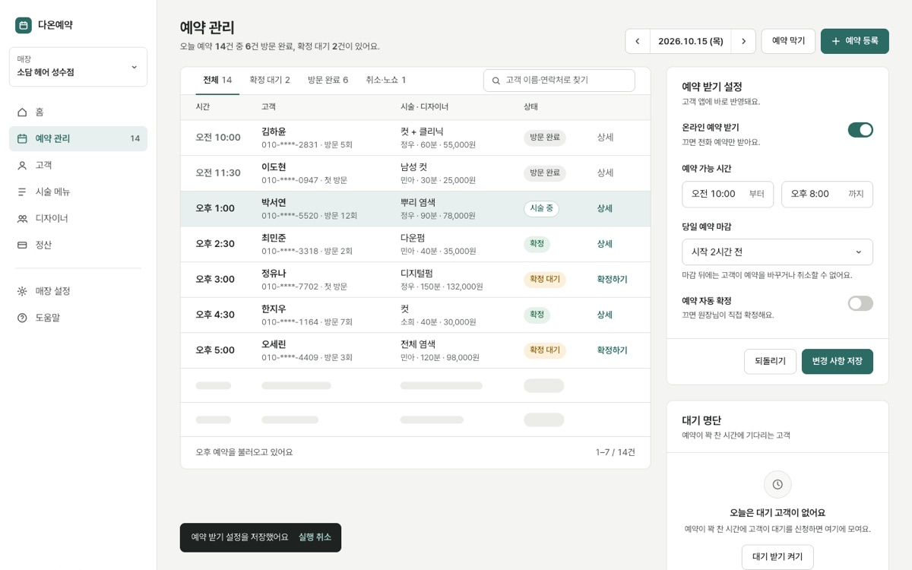</a><br><b>admin-calm</b></td></tr>
<tr><td width="50%" valign="top"><a href="docs/style-gallery.md#admin-console--다크-콘솔">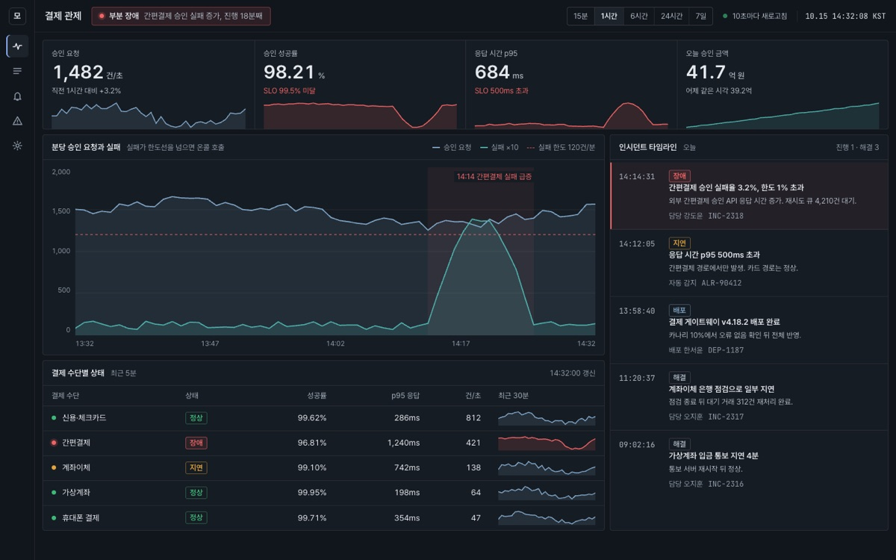</a><br><b>admin-console</b></td><td width="50%" valign="top"><a href="docs/style-gallery.md#kr-admin-classic--한국형-관리자">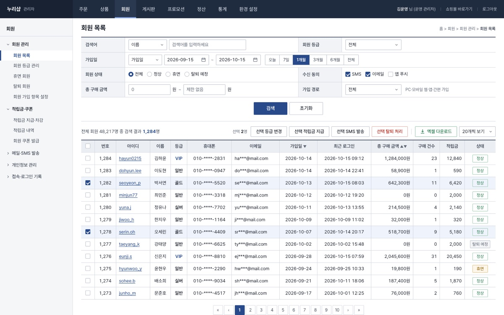</a><br><b>kr-admin-classic</b></td></tr>
</table>

**Community**

<table>
<tr><td width="50%" valign="top"><a href="docs/style-gallery.md#playful-illustrative--플레이풀-일러스트"></a><br><b>playful-illustrative</b></td><td width="50%" valign="top"><a href="docs/style-gallery.md#kr-board-classic--한국형-게시판">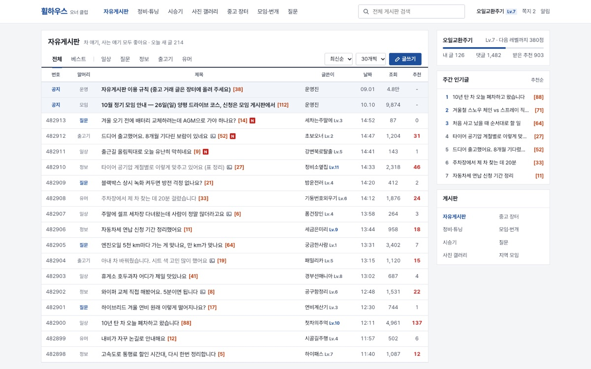</a><br><b>kr-board-classic</b></td></tr>
<tr><td width="50%" valign="top"><a href="docs/style-gallery.md#kr-local-feed--동네-피드형">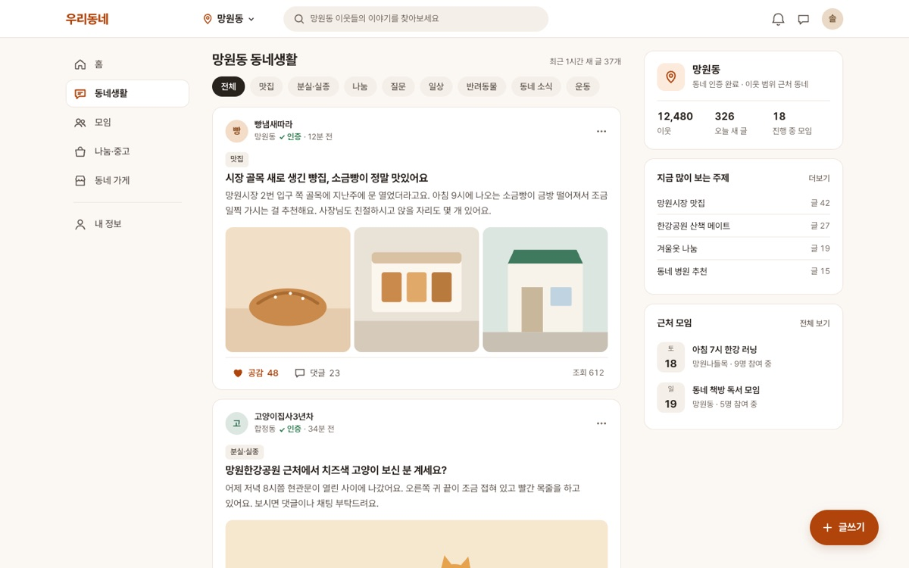</a><br><b>kr-local-feed</b></td><td width="50%" valign="top"><a href="docs/style-gallery.md#forum-thread--스레드형-포럼">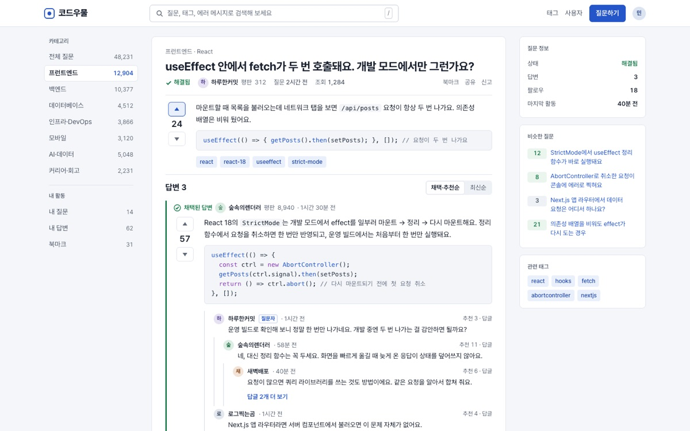</a><br><b>forum-thread</b></td></tr>
</table>

**App & commerce**

<table>
<tr><td width="50%" valign="top"><a href="docs/style-gallery.md#kr-fintech-simple--한국형-핀테크-심플"></a><br><b>kr-fintech-simple</b></td><td width="50%" valign="top"><a href="docs/style-gallery.md#kr-editorial-commerce--한국형-에디토리얼-커머스"></a><br><b>kr-editorial-commerce</b></td></tr>
</table>

**Treatments**

<table>
<tr><td width="33%" valign="top"><a href="docs/style-gallery.md#glassmorphism--글래스모피즘">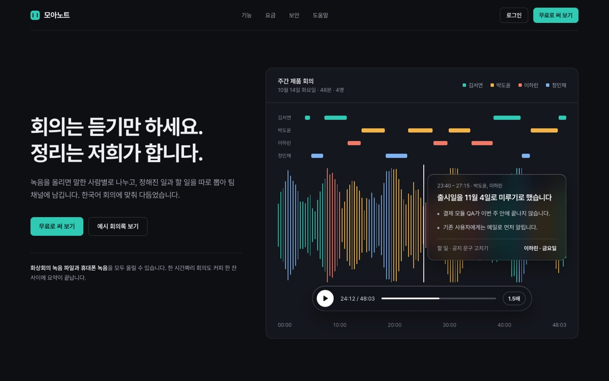</a><br><b>glassmorphism</b></td><td width="33%" valign="top"><a href="docs/style-gallery.md#neumorphism--뉴모피즘">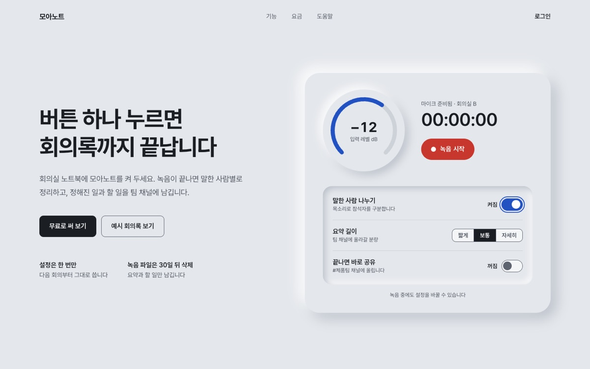</a><br><b>neumorphism</b></td><td width="33%" valign="top"><a href="docs/style-gallery.md#aurora-gradient--오로라-그라데이션">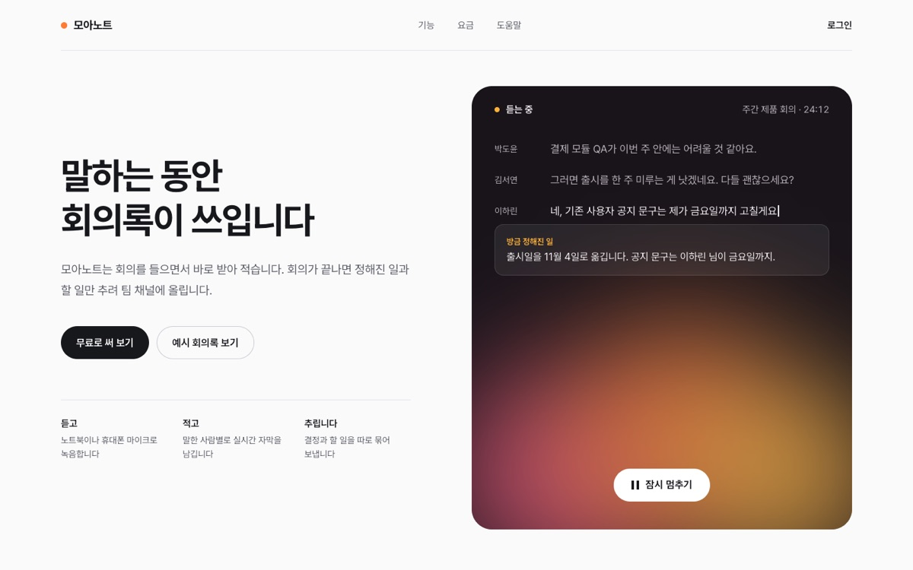</a><br><b>aurora-gradient</b></td></tr>
<tr><td width="33%" valign="top"><a href="docs/style-gallery.md#grain-noise--그레인노이즈">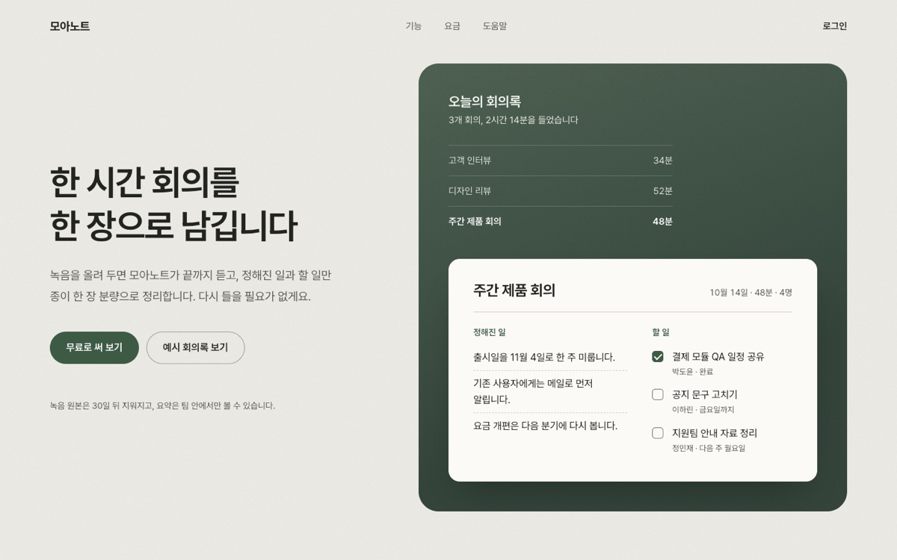</a><br><b>grain-noise</b></td><td width="33%" valign="top"><a href="docs/style-gallery.md#clay-3d--클레이-3d">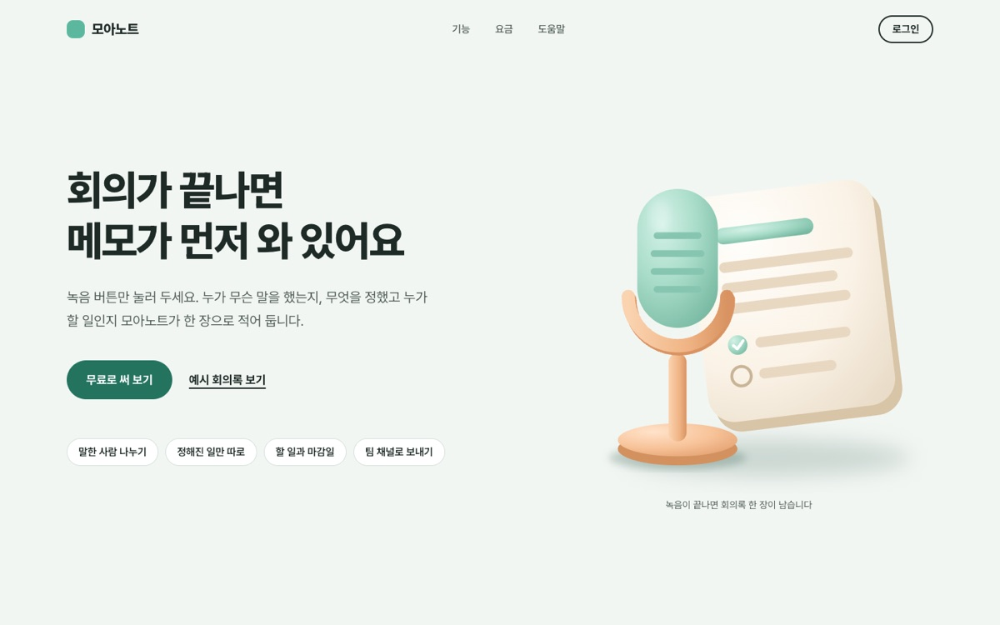</a><br><b>clay-3d</b></td></tr>
</table>

## Principles

- Brief first: nothing outside `.design/` changes before you approve.
- No copying: logos, photos, copy and paid fonts stay with their owners; proportions, rhythm and tokens transfer.
- No bypassing bot walls or logins; screenshots are used instead, and every value is tagged measured / estimated / derived / catalog.

## Development

```bash
npm test
claude --plugin-dir plugins/design-director
```

See [docs/architecture.md](docs/architecture.md) and [CLAUDE.md](CLAUDE.md). MIT License.
